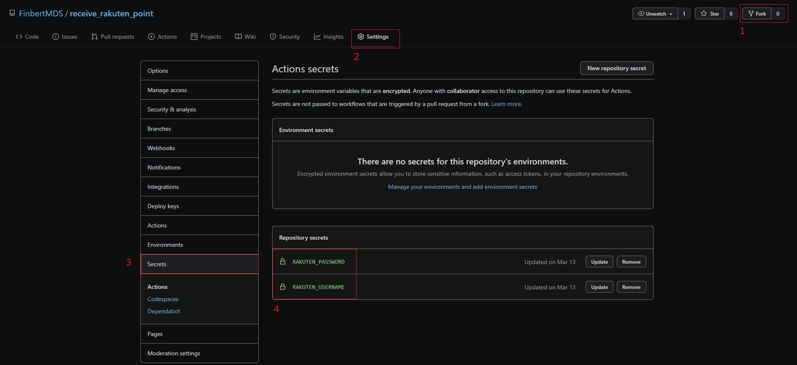
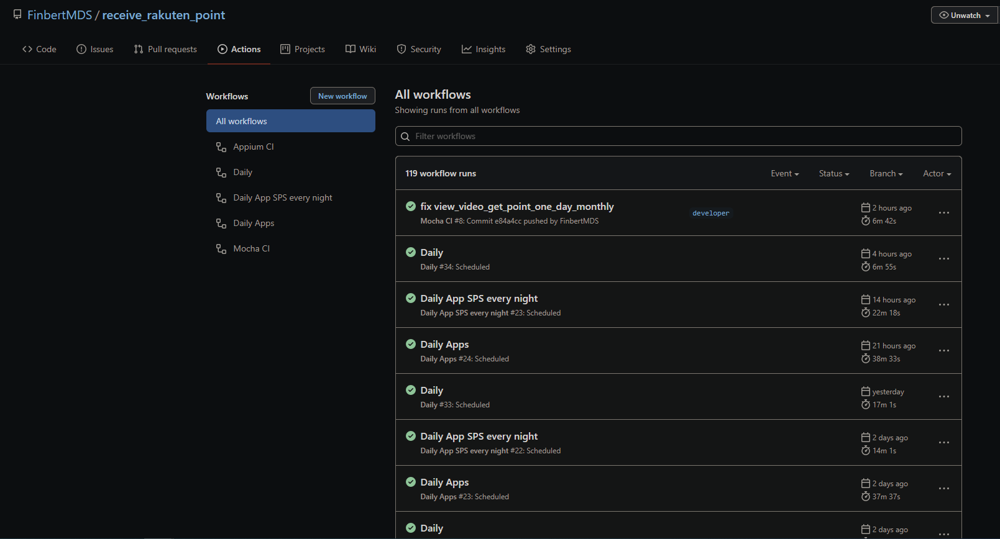

# Get Rakuten points automatically every day

## Technologies
- Branch: [master](https://github.com/FinbertMDS/receive_rakuten_point/tree/master)
  - Selenium IDE
- Branch: [developer](https://github.com/FinbertMDS/receive_rakuten_point/tree/developer)
  - WebdriverIO
  - Mocha
- Branch: [rakuten_apps](https://github.com/FinbertMDS/receive_rakuten_point/tree/rakuten_apps)
  - WebdriverIO
  - Jasmine
  - Appium


## How To Run
[How to run](HOW-TO-RUN.md) includes more details

## For Developer
If you want to automatically run every day to receive points of rakuten, you can start by forking the project and follow these steps run it with [Github Actions](https://github.com/features/actions)

1. Fork the project
2. Settings Rakuten username and password to Actions secrets

  ```
  RAKUTEN_USERNAME
  RAKUTEN_PASSWORD
  ```

  

3. View all runs from Github actions every day

  


4. Demo

Rakuten App: SuperPointScreen | Rakuten App: Kuji | Rakuten App: Point Club
---------|----------|---------
   |   | 

Rakuten Web Campain | Rakuten Web Card | Rakuten Web Kuji
---------|----------|---------
  |   | 

---
